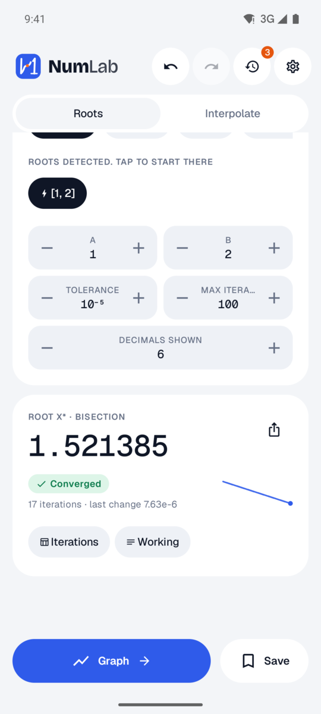
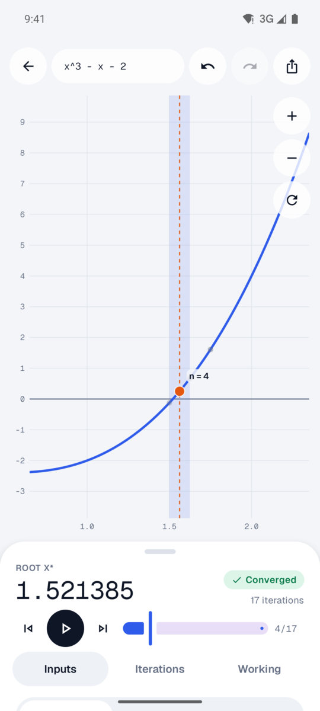
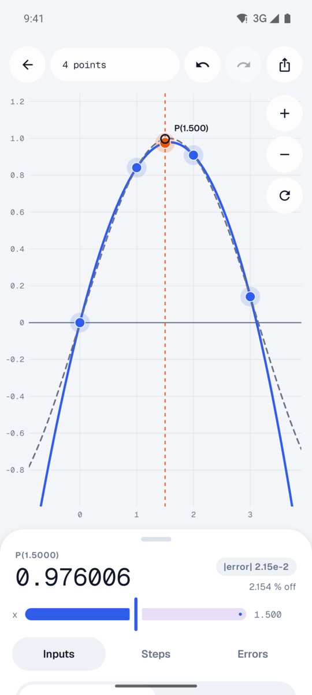
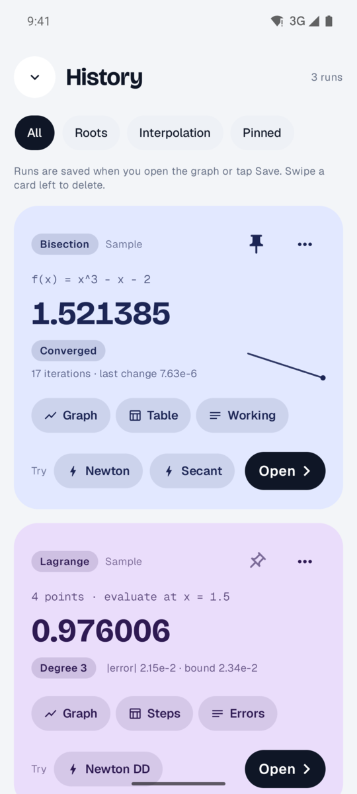
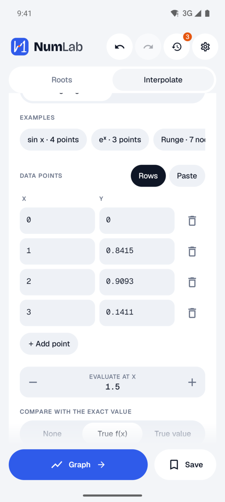
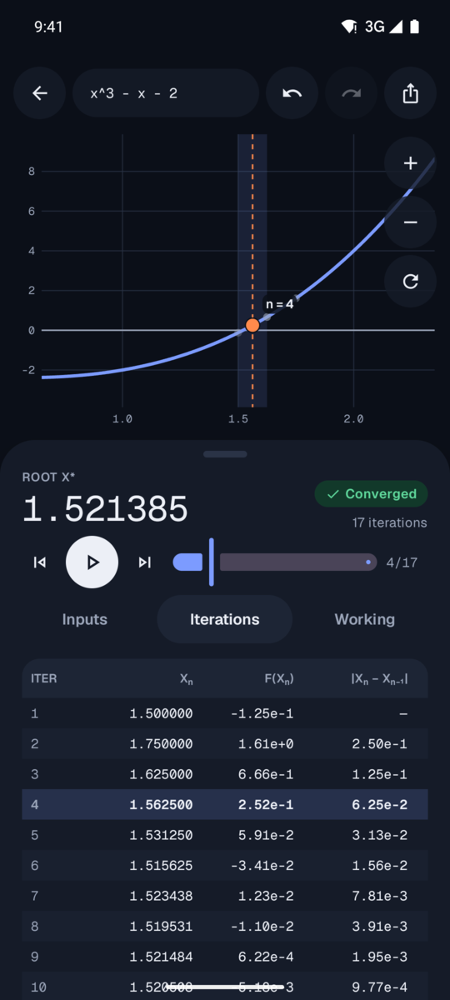
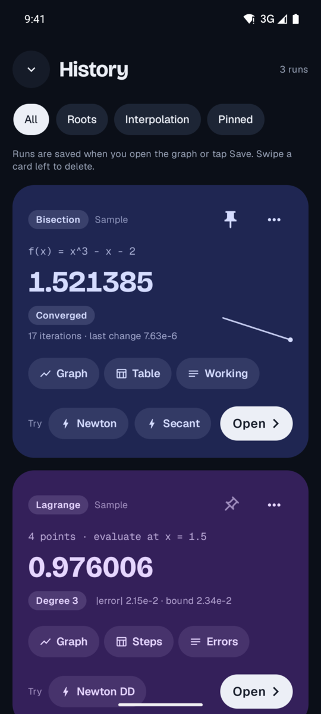

<div align="center">


# NumLab

**A numerical-analysis workbench for Android.**<br>
Find roots, interpolate data, and see every iteration step by step. Works fully offline.

[](https://github.com/Aguynamedkent7/Elective2_PIT/releases/latest)


<br>

&nbsp;
&nbsp;
&nbsp;


</div>

## Features

### Root finding
- **Bisection**, **Newton–Raphson** and **Secant** methods.
- Type any `f(x)` (`x^3 - x - 2`, `ln(x) + x - 2`, `√x`, `sin`, `cos`, `tan`, `e^x`…) or tap one of the examples.
- Suggested starting brackets when a sign change is detected.
- Full iteration table (xₙ, f(xₙ), absolute and relative error) plus a plain-language walkthrough of each step.
- Clear errors when a method can't run, such as `f(a) and f(b) must have opposite signs`. Rows computed before the error stay on screen.

### Interpolation
- **Lagrange** and **Newton divided differences**.
- Enter points row by row or paste them (`0 0, 1 0.8415, 2 0.9093`).
- Shows P(xₑ), the expanded polynomial, the Lagrange basis terms or divided-difference table, and the error.
- If you give the true function, it also shows the theoretical error bound.

### Interactive graph
- Pan and zoom the plot. Root markers, brackets and tangent or secant lines follow the iteration you select.
- An iteration player autoplays once, then you can scrub to any step.
- For interpolation, drag a data point to watch the polynomial update, or drag the evaluation line.

### Notebook history
- Runs are saved when you open the graph or tap Save. You can pin, filter and reopen them.
- Preview the same problem with another method (**Try Newton**, **Try Secant**) right on the card.
- Swipe a card to delete it, with undo.
- Export as CSV or LaTeX, or copy the result as text.

### Polish
- Light, dark and system themes.
- Respects the system's reduced-motion setting.
- Scales to 200 % font size, with TalkBack labels on every control.

<details>
<summary><b>More screenshots</b></summary>
<br>
<div align="center">
&nbsp;
&nbsp;

</div>
</details>

## Download

Get the latest APK from the [**Releases**](https://github.com/Aguynamedkent7/Elective2_PIT/releases/latest) page and open it on your phone. Android will ask you to allow installs from your browser or file manager the first time. Requires Android 8.0 (API 26) or newer.

## Building from source

**Requirements:** JDK 17+ and the Android SDK (compile SDK 37). Android Studio isn't required.

```sh
git clone https://github.com/Aguynamedkent7/Elective2_PIT.git
cd Elective2_PIT

./gradlew :app:assembleDebug        # debug APK → app/build/outputs/apk/debug/
./gradlew :app:installDebug         # install on a connected device or emulator
```

Release builds are signed with an upload key read from a git-ignored `keystore.properties`. Without that file the release build is produced unsigned. See [`docs/RELEASE.md`](docs/RELEASE.md) for the full steps.

## Testing

```sh
./gradlew test                                  # unit tests (domain math, data, view models)
./gradlew :domain:jacocoTestCoverageVerification # ≥ 90 % line coverage on :domain
./gradlew lint                                  # Android lint
./gradlew :app:connectedDebugAndroidTest        # on-device acceptance tests
```

The math engine is checked against [`docs/reference/golden.json`](docs/reference/golden.json). That file holds expected outputs generated from a reference JavaScript implementation ([`math.js`](docs/reference/math.js)), and every case must pass.

## Architecture

Single-activity app built with Jetpack Compose and Material 3. It follows MVVM with unidirectional data flow: each screen has one immutable `UiState` exposed as a `StateFlow`.

```
:app ──► :ui ────► :domain
  └────► :data ──► :domain
```

| Module | Responsibility |
|---|---|
| `:domain` | Pure Kotlin/JVM, no Android imports. Expression parser (hand-written recursive descent), root solvers, interpolation, number formatting, exports. |
| `:data` | Room database for history, DataStore for settings. |
| `:ui` | Compose screens, the custom `Canvas` plot, motion and theming. |
| `:app` | Application entry point, Hilt wiring, navigation. |

Solvers run on `Dispatchers.Default`. A new input cancels the previous calculation.

## Privacy

NumLab has **no `INTERNET` permission**, so it can't send anything off your device. There are no analytics, ads or accounts. History is stored only on your device.

## Project documents

- [`PLAN.md`](PLAN.md): scope, architecture and the phased build plan.
- [`docs/DECISIONS.md`](docs/DECISIONS.md): every deviation from the plan and why it was made.
- [`docs/RELEASE.md`](docs/RELEASE.md): signing and release process.
- [`docs/prototype-src/prototype.html`](docs/prototype-src/prototype.html): interactive design prototype (open in a browser).
